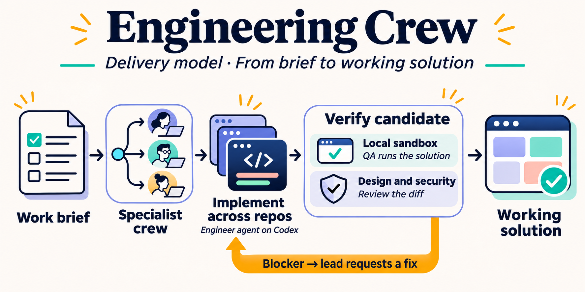
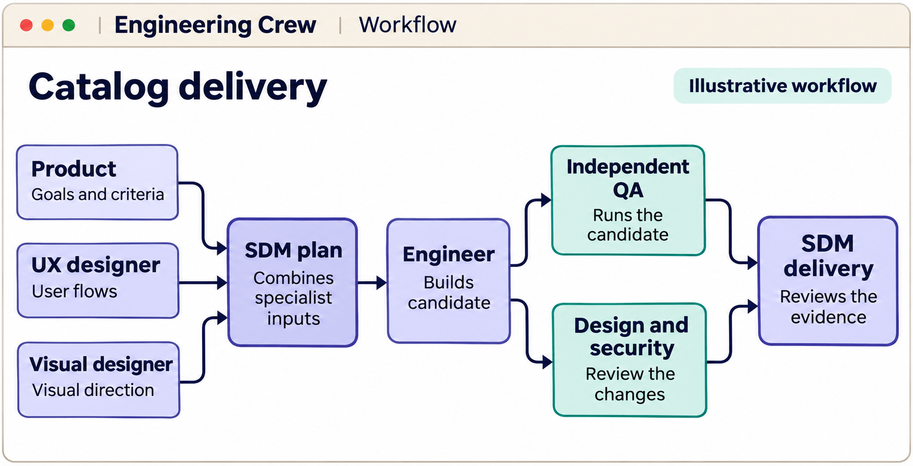
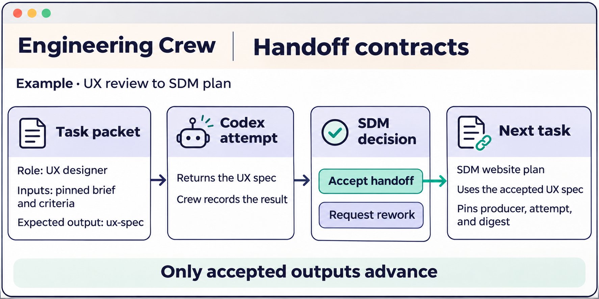

# Engineering Crew

Engineering Crew coordinates a configurable team of Codex agents to deliver
working software. Give the crew a brief and a versioned workflow. The crew
divides the work among specialists, verifies the result in a local sandbox, and
records the evidence behind each handoff.

## Run Music Transcribe

Install Node 22 or later, start Docker, and sign in with the Codex CLI.
Start the dashboard and open [Music Transcribe](http://127.0.0.1:4186/projects/music-transcribe/agents).

```sh
npm ci
npm run local -- ui --project-id music-transcribe --port 4186
```

Crew uses `CREW_DATABASE_URL` when supplied. The local launcher can also start
a loopback-only Postgres container with a persistent volume. Install Google
Chrome on the worker for browser tools. See [the Carnatic lesson
pilot](#run-the-carnatic-lesson-pilot) to prepare the local audio fixtures.

1. Open **Agents → Add agent** to set the model, instructions, and workspace
   access. Attach a saved skill from **Skills** or an MCP connection from
   **Tools**. Use **Try this draft** to test the configuration or **Run agent**
   to start a direct conversation with a saved revision. Open an agent to see
   its saved configuration and version history. The page lists project-owned
   and shared definitions.
2. Open **Workflows → New workflow** and define the assignments. Assign a
   pinned agent version to each step. Workflows have their own version history
   and can reuse the same agent. Use the dependency graph to decide when steps
   can start and which artifacts they pass forward. Codex runs each assignment
   in its native loop with the agent's configured tools and skills.
   Use **Test draft**, then **Save tested revision** to save the exact
   configuration you tested.
3. Open **Requests → New request**, choose a version of a saved workflow
   that takes a brief, and submit the brief. **Run setup** can check the
   worker's model, tools, and fixtures. The run pins the workflow version
   and brief in Postgres.
4. Open **Runs** to find the run and inspect its handoffs, original inputs,
   tool activity, outputs, and Codex execution receipts. Review and accept
   handoffs where the workflow calls for a human decision.

Open **Codex runtime configuration** in a native Music Transcribe handoff to
compare requested settings with the App Server launch response. The inspector
links to pinned skills and shows which ones were discovered or passed explicitly
for the turn. It displays MCP connection status and advertised tools when the
run's Codex thread reports them, alongside the tool calls recorded for the
attempt. Follow **View execution receipt** to inspect the stored evidence.

### Earlier feature requests

Open an earlier feature request from the same history to inspect its run.
Each request gets a permanent URL. Its overview shows
the active agents, current attempt, and latest action. If delivery stops, follow the
linked finding to the recorded check. **Workflow** shows the path Crew actually
took. Each step shows the action, who ran it, and the result. Selecting a step
opens its outcome and next decision in a side panel. On a narrow screen the
panel takes the full window. Close it to return to the selected step. Checks
that branched from the same step appear together. Switch between **DAG** and
**List** to inspect the same steps. A QA step shows the failed check, the other
check results, and the controller’s next decision. Expand **Agent output** for
the underlying report or test. **Technical details** contains the evidence links,
recorded usage and configuration for the selected step when available.

The **Legacy Feature agents** section links to role profiles for these
requests. The legacy editor shows the current model, workspace, project
instructions, skills, and tools for each role. Choose **Edit definition** to change
its model, reasoning effort, worker image, or instructions. Upload a `SKILL.md`
or paste its text to include it in the role prompt. The optional Git tools add
commit subjects or changed project paths from the role's starting revision.
Use **Add agent** to save a separate configuration for a workflow role, then
choose **Use for [role]** to activate it. A worker loads the current role
assignments when it starts or resumes a request. The configuration and calls link on a workflow step
opens the settings recorded for that role and attempt. New Codex calls keep their
exact input and returned response in the local database. Older calls show the
evidence available for that run.

**Time & tokens** shows request elapsed time and measured input, output, and time
by agent and model. Expand individual calls to inspect a receipt. On a finished request, this panel can publish the
receipts to a configured local Langfuse project. [Langfuse setup](docs/langfuse.md)

**Event log** opens on milestones. Choose **All events** for individual
tool calls and file edits. Expand **Recorded evidence** to inspect a step's inputs,
results, and causal links. Each submitted candidate has a Git diff. **Run details**
contains deadlines, revisions, and the JSON trace. On a delivered request, **Open
current app** launches the latest verified local version with its project data
volume. The worker keeps running when the dashboard is closed.

```sh
npm run local -- feature list --project music-transcribe
npm run local -- feature show lesson-replay
npm run local -- feature watch lesson-replay
npm run local -- feature diff lesson-replay 1
```

Crew uses local Git projects under `.crew-local/projects`. A later request on
the same project starts from its delivered revision. On an existing local project,
pass `--checkout /path/to/repo` on initial CLI submission to use committed source
and a separate delivery branch. A request gets one initial implementation round,
two repair rounds, and 45 minutes. Reopening a stopped worker retains its history
and original deadline. The first workspace runtime supports Node 22 apps with a
`server.mjs` entry point, `/health`, and `node --test`.

Define project agents in the operator-owned `.crew-local/profiles/<project>.json`.
Each entry under `roles` can set `id`, `model`, `instructions`, `workerImage`,
`access`, `reasoningEffort`, `skills` (objects with `name` and `content`), and
`extraTools` (`git-history` and `git-changes`). For example, `{"roles":{"security":{"id":"upload-review","instructions":"Review upload limits and how uploaded files reach subprocesses."}}}`
specializes the security reviewer. Each worker image must already be installed
locally and provide Node 22. The top-level `image` selects the separate application
image used for tests and previews. A role's explicit model takes precedence over
`CREW_CODEX_MODEL`. With both unset, the worker asks the local Codex catalog for
its default and uses the CLI's own selection if the catalog has no unique
default. The dashboard stores named definitions under `agents` and assigns them
to workflow roles under `activeAgents`. `crew feature profiles <project>` shows
the effective profiles. The trace records the selected profile and worker image digest.

The planner, code reviewer, security reviewer, and QA agent read an immutable
checkout. QA supplies independent tests. Crew gives the engineer the current file
list on every turn. An empty checkout starts with a file edit. The engineer can
read, edit, test, and submit a revision in its private `workspace-write` checkout. Setting
`access` to `read-only` on the engineer blocks implementation. All role workspaces
run with networking disabled. Profile instructions are visible in the local trace.

### Run the Carnatic lesson pilot

On macOS, prepare a local Whisper image and two original synthetic class recordings.
First-time setup also creates the legacy Feature profiles with `gpt-6-luna`.
Manage the agents used by saved workflows under **Agents**.
The generator uses built-in speech synthesis, two voices, and original sung phrases.
The answer keys remain in the operator's fixture directory during app verification.

```sh
node examples/music-transcribe/prepare.mjs
```

Open Music Transcribe in the dashboard and choose **Requests → New request**.
Select the saved Music Transcribe workflow version and use the
[lesson replay brief](examples/music-transcribe/brief.md). The planning and
implementation handoffs are reviewable from the run. The verification step
runs the local audio acceptance checks on the captured app.

Project code and recordings stay on your machine during transcription. Agent prompts
and eligible project source go to Codex during development. Model usage follows the
Codex login. The dashboard reads local Postgres directly through Crew.



The diagram shows the intended delivery model across repositories. The current
Pet Store pilot registers source from a single Git repository.

## How the crew works

1. **Triage the brief.** A configured owner reviews the pinned brief and
   confirms the team. Projects with a standing team use the assignments in
   the registered configuration. The first assignments start once the team is set.
2. **Plan the work.** The brief defines the outcome and acceptance criteria.
   Specialist agents contribute scoped reviews and a lead turns them into an
   implementation plan. Each assignment receives pinned inputs and has a
   named owner for the handoff decision.
3. **Build a candidate.** The engineer agent returns the source for its assigned
   files. Crew assembles those outputs into a candidate snapshot. Codex runs
   the agent assignments, and Crew runs the candidate and its configured
   checks in local Docker.
4. **Verify independently.** QA supplies its own cases and checks what the
   candidate actually does. Design and security specialists review the changes
   and record findings separately from the build.
5. **Fix or hand off.** The lead routes blocking findings to the implementer.
   The crew checks the revised candidate before handoff. The run retains the
   candidate diff, check results, and decisions so the project owner can
   review the outcome.

### Workflow DAG

Each arrow marks a dependency. In this example, Product, UX, and Visual Design
can work in parallel. The SDM uses their accepted outputs to plan the build.
Independent QA and specialist reviews feed the delivery decision.



### Handoff contracts

A task packet names the role, pins its inputs, and declares the expected output.
When the SDM accepts the UX spec, the planning task can use that exact artifact
and trace it to the attempt that produced it.



## Configure, run, and trace

**Postgres stores configuration and run evidence.** Crew creates its own
`engineering_crew` schema. Music Transcribe stores project-owned agents,
skill versions, MCP connection definitions, and workflow versions there.
Each run pins the configuration it used and stores its attempts, decisions,
candidate files, and evidence in the same database. Saved native Codex thread
history is kept on the worker when enabled.

**Git supplies source and agent assets.** Commit static prompts and skills
with the product source. Crew captures their contents from a Git revision
when you register a configuration, so later dispatch and replay can run
from the database snapshot.

**Workflows** lets you create and version a DAG in the browser. Define steps,
select an agent for each one, and choose which steps must be accepted first.
In the Music Transcribe **Dependency graph**, select a step and use **Add
prerequisite** to choose another node. Select **Remove** beside a prerequisite
to unlink it. The graph shows the artifact routes and other settings the
removal clears, and **Undo** restores the last graph edit. **Save new
version** records the draft when it is ready.
In Music Transcribe, open **Run setup** on a saved workflow version or from
the request form to review its pinned agents, workspace permissions, skills,
and tools. **Check worker setup** asks the dispatch worker to inspect its
model and tool catalogs and verify the attached project connections and
local Music Transcribe fixtures. The page records the result and check time
for that workflow version.
**Agents** stores each project’s reusable definitions, skill attachments, and
tool selections in Postgres. Attach a Markdown skill or upload a Codex skill
folder containing `SKILL.md` and its scripts, references, and assets. A project
can share an agent with other projects.
In Music Transcribe, use **Skills** to save a project-owned skill and attach
a specific version in **Agents**. Several agents can use the same version.
Saving a new skill version leaves existing agent and workflow revisions
pinned. In a direct native agent run, choose **Invoke skills on the first
turn** to send the selected attachments through Codex’s native skill input.
Use **Skills to invoke** on a workflow step or **Skills for this turn** in a
saved conversation to explicitly invoke attachments from that agent revision.
The activity receipt links each invocation to its pinned skill artifact.
Enable **Let Codex search for skills** on a Music Transcribe agent to opt in
to native skill search. The worker setup check reports whether Codex enables
it, and the run inspector records whether the worker discovered each pinned
attachment. Explicit invocation remains available.
Music Transcribe agent runs and follow-ups accept up to four PNG or JPEG
images, 4 MiB each and 6 MiB combined. Crew saves the original images with the
turn in Postgres and sends them as image inputs to Codex App Server. The
conversation previews the attachments and the receipt records their digests.
For workflow intake, enable **Receive request images** on the steps that need
them. The request form lists those steps before upload. Each receiving step
gets the request images as native Codex inputs and records their digests.
Steps that copy an earlier Codex conversation use compatible image routing
because that conversation may contain the attachments.
Music Transcribe opens this editor from **Agents**. An agent’s version
history shows the saved settings and which workflow versions use them.
Workflow steps link back to their pinned agent revision. Open **Legacy
Feature agents** to see the profiles used by earlier requests. Use **Copy as
reusable agent** to review a profile’s model, reasoning effort, instructions,
skills and workspace settings in a new definition. The copy has a source
profile digest and its own revision history. Choose its tools and review
its instructions before saving it for workflows or direct runs.
Open a saved agent and choose **Run agent** to try its current version with
a prompt and optional reference text. The runner records its result, Codex
activity, and evidence in Postgres. Recent runs appear with that agent.
In the Music Transcribe agent editor, open **Try this draft** to test the
current fields with a prompt, optional reference text or images, and a choice
of starting files. The editor keeps your changes while the test runs in a
separate handoff. **Runs → Agent draft test** links to the definition, reply,
and execution receipt recorded in Postgres.
Music Transcribe uses Codex App Server for saved agents. Direct runs send
the user message and saved agent instructions as separate native inputs.
The conversation shows the reply as it arrives. The final reply is stored
verbatim, together with its execution receipt and exact turn input.
Under **Codex response mode** on a Music Transcribe workflow step, choose
**Free-form reply and output tools** to let Codex submit named artifacts
during the turn and write a separate reply. Crew checks the required outputs,
their formats, and any configured acceptance checks before advancing.
The handoff links to the final reply and the recorded submissions.

Set **Missing output follow-up turns** to allow one to three reminders for
a free-form step with required outputs. The default is **Off**. After Codex
finishes a turn, Crew can name the missing slots and continue in the same
thread with the same workspace and acknowledged outputs. The step timeout
covers all turns. A reported blocker or a stop request ends the follow-ups.
The handoff links to the exact reminder, previous reply, and native turn IDs.

### Direct agent runs and saved conversations

In Music Transcribe, choose **Use published workspace** in the **Run agent**
form to run the agent against the exact delivery shown there.
If the agent saves Codex history, open the run’s **Conversation** to send a
follow-up on the same thread or fork it from the latest turn. Crew queues the
message in Postgres and keeps each turn’s reply and evidence linked to the
same run and agent revision. Editable workspaces save completed file changes
for the next turn.
A workflow version pins the selected agent revisions and their content. Codex
runs the assignment and can call the selected MCP tools to list, search, or
read pinned inputs and load an attached skill. Agent settings also control
reasoning effort, web search, and native shell and file tools in an isolated
copy of the assignment’s files. Attach configured MCP servers from the Codex
host in the agent editor. Workflow versions pin the server names. Codex loads
their current host configuration, sign-in, and tool policies at dispatch.
Music Transcribe’s **Codex speed** setting offers Worker default, Standard,
and the additional tiers listed by the worker for the selected model.
Saved agents and workflows pin the selection. The run receipt shows the
tier Codex App Server reports, and a mismatched explicit tier stops the
attempt before the turn starts. Faster tiers can use more of your
allowance. [Codex speed documentation](https://learn.chatgpt.com/docs/agent-configuration/speed)
Use `TMPDIR` for temporary files in either native workspace mode. A read-only
workspace allows writes to that scratch directory. Crew discards scratch
files at the end of the assignment. Enable **Save shell command details** to
record commands, exit codes, and output excerpts with the attempt in Crew.
Use **Tools** to create project-owned MCP connections over local stdio or
Streamable HTTP. Agents attach a specific connection version, and a workflow
pins that configuration across runs. Use worker environment variable names
for tokens and credential headers.
In Music Transcribe, open a saved connection version and choose **Check tools
on worker** to start it and discover its catalog through Codex. Crew shows
the tools allowed by that version, their configured approval policies, and
the names of any missing worker environment variables. The **Run setup** panel
links to the exact connection and skill versions attached to the saved agent.
For an OAuth-protected HTTP tool, enable **Sign in with OAuth**, save the
connection, and open **Connect with OAuth**. Codex handles the authorization
and stores its credentials on the worker. Changes to the endpoint or OAuth
scopes use a separate authorization. Agents continue using the connection
version pinned by their workflow.
Attach installed Codex plugins in **Agents** to let Codex find their skills
and bundled MCP tools. Workflow revisions pin plugin IDs. Runs record the
installed versions resolved on the worker and the tool calls Codex reports.
Open **Connected Codex apps** to attach apps from the worker’s Codex
account. Codex scopes the run to the selected apps and applies the worker’s
existing tool and approval policies. Activity identifies which app each
reported tool call belonged to.
In **Native Codex capabilities**, enable workspace image inspection or let
Codex delegate within a step. Set subagent model, reasoning, and concurrency
defaults when the workflow needs them. The handoff records the selected
capabilities and the delegation events reported by Codex.
In Music Transcribe, enable **Generate images with Codex** to use native
image generation on an eligible model and account. The conversation and
handoff link the generated PNG or JPEG and its tool evidence. Crew records
up to four images, 4 MiB each and 6 MiB combined per attempt.
For a workflow step with image generation and free-form replies, add a
**Generated image** output. Codex lists the images saved by that attempt
and submits the selected artifact to the named slot. Mark the slot
required and select it under a downstream step’s prerequisite artifacts
to send the exact accepted image as a native Codex input. The downstream
receipt links the producing attempt and records the image digest.
Attach **Browse Music Transcribe workspace** to an agent with a native
workspace to inspect its running app in the worker’s Chrome browser.
The tool opens a disposable copy of the staged files in Docker. Codex can
inspect accessible controls, click or type, change the viewport, and use
the pinned synthetic lesson. Use the restart action to check workspace
edits in a fresh browser and app. The handoff includes browser actions and
screenshots with the workspace digest. Install Google Chrome on the worker
to use this tool.
Use the browser's media observation action to sample the playback clock,
rate, and paused state. Include a control click in the same observation
to measure the clock immediately after a seek or restart. In a free-form workflow step, declare **Browser
screenshot** and **Browser observation** outputs. Codex submits their
recorded artifact IDs. A downstream agent can receive the exact screenshot
as an image input and read the observation linked to the producing attempt.
To review the whole browser session, choose **Browser action log** under
the downstream step’s prerequisite artifacts. Crew passes every saved
action record from the accepted attempt, including failed actions. Also
choose **Music Transcribe acceptance receipt** to pass the runner’s
Node, health, and audio results. Stage the accepted workspace when the
reviewer needs to inspect the test source.
Add **Specialist subagents** to give Codex named roles with their own
instructions, model, and reasoning effort. The parent agent supplies the
workspace permissions and tools. Runs link to the pinned role files.
Open **Lifecycle hooks** to paste a native `hooks.json` definition and
review it before saving. Codex runs the commands or attached MCP tools at
the configured events. Workflow revisions pin the definitions and their
Codex trust hashes. Choose **Use trusted hooks from the Codex host and
attached plugins** when the agent also needs hooks reviewed on the worker.
The workflow editor shows dependency order and accepts per-step execution
budgets. Save named text inputs with the workflow, define each step’s
Markdown, JSON, or plain-text outputs, and choose which required artifacts
each accepted prerequisite passes forward. Crew records the launch,
exact prompt, tool calls, and final response with the handoff. While a
step runs, the handoff shows recent Codex messages and tool events. Each
attempt links to its recorded activity. Use
**Create run from vN** to open a run with that configuration.

In Music Transcribe, choose **Test draft** in the workflow editor to run its
current fields and pinned inputs through Codex. Keep the editor open while
you inspect the test's handoffs, outputs, and checks in a separate tab.
**Recent draft tests** lists those runs. **Save tested revision** records the
exact tested snapshot as a saved workflow revision if the base version still
matches. Local delivery is available from saved workflow runs.
Use **Compare revisions** in the Music Transcribe agent or workflow editor to
inspect before-and-after settings. **Compare tested draft** compares the
recorded test snapshot with the saved version it was based on.

In Music Transcribe, enable **Use repository instructions** on a read-only
or editable agent. Codex can then discover `AGENTS.override.md` or `AGENTS.md`
at the root of its starting workspace. For a direct run, **Run setup** previews
the committed file and pins its Git revision. When using a published workspace,
Codex uses the file in that delivery. Workflow authors include the instruction
file in **Pinned project files**, or supply it through a workspace handoff.
The run links the exact starting instruction file and its digest. Use a
workspace without Codex project configuration files for this mode.

In **Run condition and branch joins**, compare a JSON value from an accepted
prerequisite to choose whether a step runs. Crew records the decision and
its source artifact with the run. A branch join can continue after a selected
prerequisite is accepted or skipped, and receives the artifacts from accepted
prerequisites.

Set **Dispatch** to start ready steps automatically. For Music Transcribe,
run the worker and dashboard in separate processes so Codex can keep working
while the dashboard restarts. Both use the same local Postgres database:

```sh
npm run local -- worker --project-id music-transcribe
npm run local -- ui --project-id music-transcribe --port 4186 --external-worker
```

The Requests page and workflow pipeline show whether the worker is connected.
Queued assignments wait in Postgres while it is offline. Stopping the worker
with SIGTERM lets active attempts finish and saves newly ready work for the
next worker. A dashboard started without `--external-worker` processes its
project queue in the dashboard process. Each step
defaults to human acceptance. Choose **Accept after evidence validation**
for steps that can advance after Crew verifies the execution receipt and
required outputs. Codex approvals follow the saved agent policy.
Use **Pause dispatch** in the run’s **Workflow** view to hold new starts.
Use **Resume dispatch** to queue the remaining work.

If a Music Transcribe worker disconnects mid-turn, open the handoff and
choose **Recover handoff**. Crew verifies that the attempt has lost its
worker before closing it. The recovery record contains the saved Codex
progress, acknowledged output submissions, and tool calls whose completion
is unknown. Review those actions before continuing a saved thread or
starting another attempt. The retry receives the recovery record as input.
For editable steps that save workspace files, Codex can call
`checkpoint_workspace` to save the current files to Postgres. The Music
Transcribe development check also saves the exact files it stages for testing.
Recovery starts from the latest verified checkpoint. The handoff links the
checkpoint, and edits made after it may need to be recreated. Crew captures
the completed workspace separately for review and acceptance.
After a rework decision exhausts a Music Transcribe step’s attempt limit,
**Allow one more attempt** records the reason and extends just that run.

Use **Pinned project files** to include committed paths from the project's
Git checkout. Set a step’s **Stage files from** to those files or to an
accepted prerequisite's captured workspace. Enable **Save workspace files**
on an editable Codex step to keep the files it actually wrote in Postgres.
Crew stages accepted files in the next agent’s isolated workspace and links
to the capture and Codex receipt from the handoff. Rework starts from the
previous captured files when available.

Music Transcribe verification steps can enable **Run Music Transcribe audio
acceptance**. A workflow version pins the local Docker image, verifier, and
both recording fixtures. Crew runs Node tests, checks `/health`, and sends
the sample and held-out recording to the application. **Checks** links each
result to the workspace tested. A failed check prevents acceptance.
Attach **Check Music Transcribe sample** in an agent’s **Codex tools** to
let it run Node tests, health, and the development recording as it works.
The agent revision pins the runtime image and development recording. The
handoff records each development check with the tested file digests and
observed timings. Independent acceptance runs through the workflow’s
verification step.
Configure **Repair after a failed check** to open a bounded repair round when
a check records a failure. Crew reopens the workspace-producing step and its
dependents. The repair receives the tested files, check receipt, and repair
decision. When the source agent saved its Codex conversation, the repair
starts from a fork of that conversation.
Choose **Send back for repair** on a Music Transcribe verification handoff
to return a review finding with the tested workspace, even after the
automated checks pass.

Enable local delivery on the verification step to add a **Delivery** tab.
After the checks pass and handoffs are accepted, **Publish local delivery**
records the verified workspace, Docker image, and acceptance receipt together.
**Open delivered app** launches that workspace on loopback. Each published
run has its own application data volume, which survives **Stop local app**.
Set a Music Transcribe step to **Latest published workspace** to carry the
verified files into the next request. **New follow-up request** on a delivery
pins that specific run. The new run links to the original workspace and
records its digest. On the first open of a follow-up delivery, Crew copies
saved lesson records and their original audio from that previous delivery.
The new delivery keeps its own data volume for subsequent imports.
Before the first delivery, the step uses any pinned Git
workspace and its assignment inputs.

Enable **Live Codex session** in an agent definition to answer Codex’s
questions, send guidance, or stop the active turn from a handoff. Crew
starts the Codex App Server with the agent’s workspace and tool settings.
The attempt records the questions, submitted answers, delivery status,
and native thread and turn IDs. The turn runs within the step’s timeout.
Set **Codex approvals** to **Review when Codex requests it** to review
commands, file changes, and permission requests from the handoff. A connected
MCP tool can also request a structured form or ask you to open a site. Submit
the form, open the site in a new tab, decline, or cancel from the handoff.
Crew records the decision and delivery status, keeps the destination origin
for site requests, and clears temporary form values after the request settles.
The connected tool reports the result of the site interaction to Codex.

Enable **Save Codex thread history** to keep the conversation on the
worker. After a rework decision, choose **Continue saved Codex thread**
to open a new turn with that history. A workflow step can also copy the
conversation through the accepted turn of a direct prerequisite that
uses the same saved agent version. The new assignment stages its own
workspace and records the source attempt in Postgres.

If a workflow worker loses its Postgres connection, the handoff shows
**Recover handoff**. Recovery closes the interrupted attempt and records
any pending input, operator actions, and recent activity that had reached
Postgres. Continue a saved Codex conversation or start another attempt
from the handoff when you’re ready to run Codex again.

Use **Workflow** in a run to dispatch assignments
and inspect their inputs and outputs. Accept a handoff to make its output
available to dependent tasks, or request rework with a note for the next
attempt. **Checks** shows recorded Docker results, and **Activity** preserves
the decision history. The browser and automation use the same CLI.

**Langfuse is an optional drill-down.** Export a selected attempt through the
CLI and open its verified trace link from the run. A receipt shows the Codex
outcome, timing, and reported token usage. With activity capture enabled, the
trace can also include the prompt, reply, and recorded Git and Docker
actions. [Set up Langfuse](docs/langfuse.md)

## Run the pilot

The Pet Store pilot has two epics. Each demonstrates a different part of the
delivery workflow.

| Epic | What it demonstrates |
| --- | --- |
| Catalog command | Product and engineering planning, a Node.js implementation, and independent Docker QA against the candidate CLI. |
| Catalog website | A website prototype, design and security reviews, a Docker smoke test of the source, and one fix loop. |

You’ll need Git, Node.js 22 or later, a signed-in Codex CLI, Docker, and a
Postgres connection. Supply `CREW_DATABASE_URL` in the environment. The
connection role needs permission to create the Crew schema on first use.
The example JSON files are sample inputs to the registration command.

```sh
git clone https://github.com/bhadrip/engineering-crew.git
cd engineering-crew
npm ci
node bin/crew.mjs db init
docker pull node@sha256:fe4f6d74e20370acb04ad889077d14d0f64a9c8ea6a42bc60cddf1e844699914

node bin/crew.mjs project register --file examples/hello-world/crew.project.json
node bin/crew.mjs project register --file examples/hello-world/website.crew.project.json
node bin/crew.mjs run start epic-1 --project pet-store --epic epic-1
node bin/crew.mjs run start epic-2 --project pet-store --epic epic-2
node bin/crew.mjs ui
```

Open the local URL printed by the CLI and select an epic. The catalog command
starts its first assignments with the standing team. For the website, open
the pinned brief in **Triage**, select an owner, and choose **Confirm and start**.
Review the results in **Workflow**. As you accept handoffs, dependent
assignments become available to dispatch.

## Reference

- [Workflow reference](docs/workflow-reference.md) covers triage, resource
  approvals, replay, fix loops, run records, and usage.
- [Design and contracts](docs/design/engineering-crew.md) describes the
  execution boundaries and handoffs.
- [Agent development and evals](docs/agent-development.md) shows how to build
  and benchmark a specialist profile.
- Run `npm test` for offline checks. Set `CREW_TEST_DATABASE_URL` to a
  disposable Postgres server with database creation permission to include
  the database integration tests.
