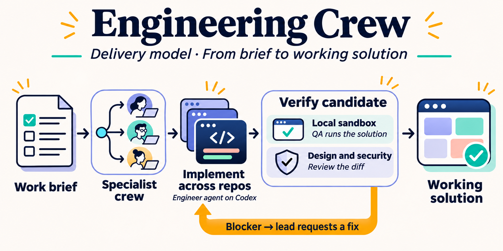
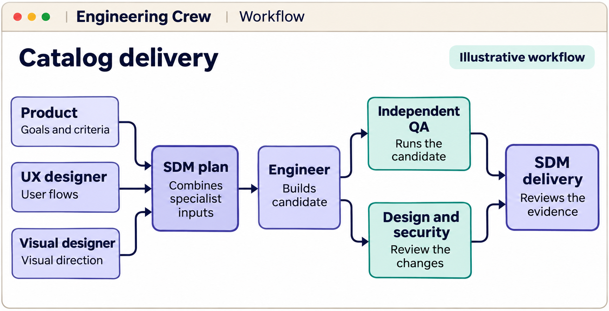
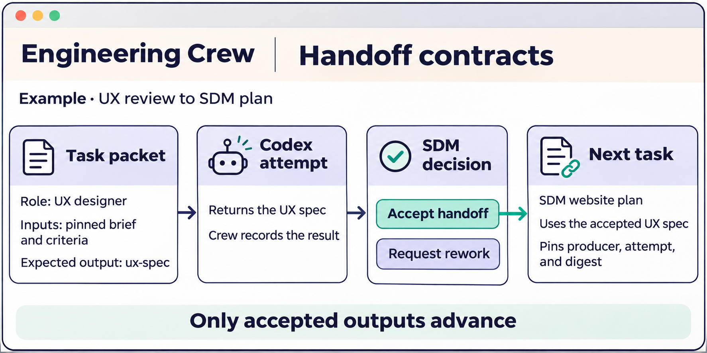

# Engineering Crew

Engineering Crew coordinates a configurable team of Codex agents to deliver
working software. Give the crew a brief and a versioned workflow. The crew
divides the work among specialists, verifies the result in a local sandbox, and
records the evidence behind each handoff.



The diagram shows the intended delivery model across repositories. The current
Pet Store pilot registers source from a single Git repository.

## How the crew works

1. **Triage the brief.** A configured owner reviews the pinned brief and
   confirms the team. Projects with a standing team use the assignments in
   the registered configuration. The first assignments start once the team is set.
2. **Plan the work.** The brief defines the outcome and acceptance criteria.
   Specialist agents contribute scoped reviews and a lead turns them into an
   implementation plan. Each assignment receives pinned inputs and has a
   named owner for the handoff decision.
3. **Build a candidate.** The engineer agent returns the source for its assigned
   files. Crew assembles those outputs into a candidate snapshot. Codex runs
   the agent assignments, and Crew runs the candidate and its configured
   checks in local Docker.
4. **Verify independently.** QA supplies its own cases and checks what the
   candidate actually does. Design and security specialists review the changes
   and record findings separately from the build.
5. **Fix or hand off.** The lead routes blocking findings to the implementer.
   The crew checks the revised candidate before handoff. The run retains the
   candidate diff, check results, and decisions so the project owner can
   review the outcome.

### Workflow DAG

Each arrow marks a dependency. In this example, Product, UX, and Visual Design
can work in parallel. The SDM uses their accepted outputs to plan the build.
Independent QA and specialist reviews feed the delivery decision.



### Handoff contracts

A task packet names the role, pins its inputs, and declares the expected output.
When the SDM accepts the UX spec, the planning task can use that exact artifact
and trace it to the attempt that produced it.



## Configure, run, and trace

**Postgres stores the workflow and its runs.** Provide a customer-managed
Postgres database. Crew creates its own `engineering_crew` schema. Register a
project and epic configuration to version their assignments, inputs, policies,
and checks. Each run pins that version and stores its attempts, decisions,
candidate files, and evidence in the same database.

**Git supplies source and agent assets.** Commit static prompts and skills
with the product source. Crew captures their contents from a Git revision
when you register a configuration, so later dispatch and replay can run
from the database snapshot.

**The browser UI operates the run.** Use **Workflow** to dispatch assignments
and inspect their inputs and outputs. Accept a handoff to make its output
available to dependent tasks, or request rework with a note for the next
attempt. **Checks** shows recorded Docker results, and **Activity** preserves
the decision history. The browser and automation use the same CLI.

**Langfuse is an optional drill-down.** Export a selected attempt through the
CLI and open its verified trace link from the run. A receipt shows the Codex
outcome, timing, and reported token usage. With activity capture enabled, the
trace can also include the prompt, reply, and recorded Git and Docker
actions. [Set up Langfuse](docs/langfuse.md)

## Run the pilot

The Pet Store pilot has two epics. Each demonstrates a different part of the
delivery workflow.

| Epic | What it demonstrates |
| --- | --- |
| Catalog command | Product and engineering planning, a Node.js implementation, and independent Docker QA against the candidate CLI. |
| Catalog website | A website prototype, design and security reviews, a Docker smoke test of the source, and one fix loop. |

You’ll need Git, Node.js 22 or later, a signed-in Codex CLI, Docker, and a
Postgres connection. Supply `CREW_DATABASE_URL` in the environment. The
connection role needs permission to create the Crew schema on first use.
The example JSON files are sample inputs to the registration command.

```sh
git clone https://github.com/bhadrip/engineering-crew.git
cd engineering-crew
npm ci
node bin/crew.mjs db init
docker pull node@sha256:fe4f6d74e20370acb04ad889077d14d0f64a9c8ea6a42bc60cddf1e844699914

node bin/crew.mjs project register --file examples/hello-world/crew.project.json
node bin/crew.mjs project register --file examples/hello-world/website.crew.project.json
node bin/crew.mjs run start epic-1 --project pet-store --epic epic-1
node bin/crew.mjs run start epic-2 --project pet-store --epic epic-2
node bin/crew.mjs ui
```

Open the local URL printed by the CLI and select an epic. The catalog command
starts its first assignments with the standing team. For the website, open
the pinned brief in **Triage**, select an owner, and choose **Confirm and start**.
Review the results in **Workflow**. As you accept handoffs, dependent
assignments become available to dispatch.

## Reference

- [Workflow reference](docs/workflow-reference.md) covers triage, resource
  approvals, replay, fix loops, run records, and usage.
- [Design and contracts](docs/design/engineering-crew.md) describes the
  execution boundaries and handoffs.
- [Agent development and evals](docs/agent-development.md) shows how to build
  and benchmark a specialist profile.
- Run `npm test` for offline checks. Set `CREW_TEST_DATABASE_URL` to a
  disposable Postgres server with database creation permission to include
  the database integration tests.
