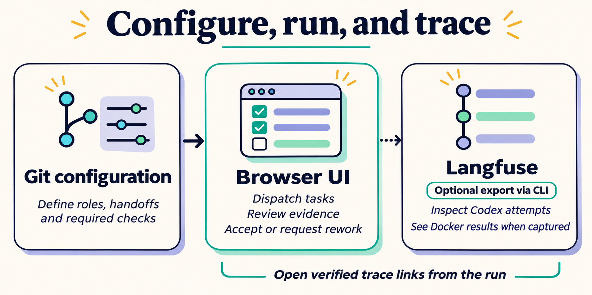

# Engineering Crew

Engineering Crew coordinates specialist agents to turn a work brief into a
working solution. The intended delivery model spans the repositories the
solution needs, with QA running the result in a local sandbox before handoff.


Codex runs the agent assignments. The engineer owns implementation, and design
and security review the changes independently. When verification surfaces a
blocker, the lead sends it back to the engineer and the crew checks the revised
candidate.

The current **Pet Store** pilot runs in a single checkout. Its catalog command
demonstrates independent Docker QA. Its website demonstrates the design and
security fix loop alongside a Docker source smoke test.

## Configure, run, and trace



Define roles, handoffs, and checks in Git. Use the browser UI to dispatch
assignments, inspect evidence, and accept handoffs or request rework. To drill
into a selected attempt, publish its Codex receipt from the CLI and open the
verified Langfuse link in the run. Optional activity capture can also include
the prompt, response, and Docker results.
[Langfuse setup](docs/langfuse.md)

## Run the pilot

The pilot project is **Pet Store**, with **Beaver Crew** as its configured team.
Epic 1 proposes a catalog command for the standalone Hello World example.
Run the implementation with `node examples/hello-world/hello.mjs --list-pets`.
Epic 2 starts with UX and visual design reviews of a catalog website brief.
After a prototype build, those designers return alongside the Lead Designer
and Security Engineer to review the candidate.

Use Node.js 22+, Git, a logged-in Codex CLI, and Docker with the pinned Node
image from `examples/hello-world/crew.project.json` available locally. Run
these commands from a checkout that has committed the files under
`examples/hello-world`. For a replay, use `--ref` to pin the pre-change commit.
Use `--repo /path/to/checkout` before the command for a separate project checkout.

```sh
node bin/crew.mjs project validate --project examples/hello-world/crew.project.json
node bin/crew.mjs run start epic-1 --project examples/hello-world/crew.project.json
node bin/crew.mjs run start epic-2 --project examples/hello-world/website.crew.project.json
node bin/crew.mjs ui
```

The printed loopback URL opens **Pet Store** directly. Find an epic by name or
filter by status. In an epic, **Overview** shows recent decisions, **Workflow**
opens handoffs, **Checks** shows observed results when configured, **Usage**
shows task ownership and usage, and **Activity** shows the full history.
Search the current run by handoff name, artifact title, criterion
ID, or commit. **Beaver Crew** shows the roster and committed orchestration
settings for each epic.

For automation, use `node bin/crew.mjs --help`. `workspace show` lists projects
and epics in the selected checkout. `run show` returns the exact run the UI
displays, `artifact read` opens one attachment, and `task dispatch --events`
emits machine-readable attempt events. `npm test` runs the offline checks.

Git controls the project configuration, epic brief, profile instructions, and
other assignment inputs. Starting a run pins them to the selected commit.
Attempt records and their attachments live in the checkout's private Git
directory under `engineering-crew/runs`. The Codex receipt shows runtime outcome
and reported usage when available. The build runner creates an isolated Git
candidate ref. Separate Docker receipts record the author tests and independent
QA outcomes on that same commit.

Publish a Codex receipt or opt in to capturing and publishing the prompt,
response, and runner checks for a handoff. Verified traces appear in the epic
view. [Langfuse setup](docs/langfuse.md)

Codex profiles receive only the inputs in their task packets. Configure roles,
dependencies, allowed build outputs, and verification in the project JSON.
Each downstream attempt records the accepted producer, slot, attempt,
artifact ID, and digest for every handoff. A retry receives the decision
owner's rework note with its pinned inputs.

Set a project `costOwner` or override it with `budget.costOwner` on an
individual task. The decision owner is the fallback for new tasks. The cost
owner uses **Usage** or `run show` to review totals, missing records, and
overruns before deciding whether more attempts are warranted. To estimate USD
cost, pin `runtime.model` and provide `runtime.tokenRates` with
`inputUsdPerMillion`, `outputUsdPerMillion`, and optionally
`cachedInputUsdPerMillion`. If the cached rate is omitted, all input uses
the input rate. A task can set `budget.costTargetUsd` for the sum of its
attempts, including retries. Cost is an estimate from reported tokens.
Missing usage or rates leave the cost unknown.

### Implementation review and fix loops

Configure the review loop in the epic's Git JSON. `orchestration.buildTask`
names the candidate builder, `reviewTasks` names the independent reviews, and
`decisionOwner` names who chooses whether to request a fix. Set
`maxFixLoops` from 0 to 5. Each review receives the accepted candidate and
its diff and returns a required `review-findings` JSON array with a stable
`id`, `severity` (`blocker` or `backlog`), `title`, and `evidence`
for each finding. Make the delivery task depend on the reviews it needs.

Blockers prevent acceptance. Backlog findings remain in the epic without
preventing delivery. After all reviews return evidence for the same candidate,
the decision owner can use **Reviews → Request fix loop** or run:

```sh
node bin/crew.mjs run fix <run> <build-attempt-id> --note "Address the blockers"
```

This reopens the build and its downstream tasks. Dispatch the reopened build
to pass it the previous diff, findings, and decision note. The replacement
source must change, and reviews must run again. Planning and previous attempts
stay in history. The website example configures one fix loop and uses source
review and a Docker smoke test. Rendered visual and interaction checks require
browser evidence. New configuration applies to new runs.

The preview runs locally. If the checkout has runs for multiple projects,
choose one with `crew ui --project-id <project>` or `crew ui <run>`.
[V1 design](docs/design/engineering-crew.md)

### Agent skills and evals

The [Security Engineer](docs/security-engineer-pilot.md) and [SDM](docs/sdm-pilot.md)
use researched skills and fixed behavioral benchmarks. The
[agent development pattern](docs/agent-development.md) explains how to develop
another role. Changes to active skills require fresh eval evidence;
`npm test` regrades the recorded results offline.
