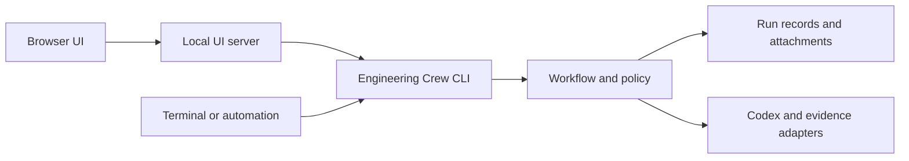
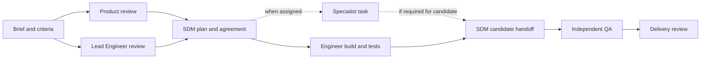

# Engineering Crew: V1 design

**Status — proposed for discussion.** The repository is `engineering-crew`. A
consumer project can set its own crew display name, such as **Beaver Crew**.
Project, run, and role IDs are independent of the display name.

Engineering Crew is a reusable software team that a project can bring in. It
supplies role templates, a handoff contract, a CLI for crew operations, and a
browser UI for working with the crew. V1 runs on Codex. The proposed first epic
adds a tiny pet store catalog to the standalone Hello World CLI. Personal School is a later
client. [Hello World baseline](../../examples/hello-world/README.md)

## Use cases to design for

| User | What they need to do | What the framework has to support |
| --- | --- | --- |
| Project owner | Bring Beaver Crew into a project and ask for a small feature. | A project config selects roles and policy. An epic captures intent and criteria before the first assignment. |
| SDM | Ask Product and Lead for independent reviews, then agree a plan with both. | Distinct review outputs, explicit prerequisites, a versioned plan, and approvals against that version. |
| Engineer and QA | Build a feature and verify it independently. | Each actor gets a bounded packet. QA receives the integrated candidate and can return a failed criterion and reproducer for rework. |
| Project maintainer | Bring a specialist they already use, such as an AWS deployment reviewer. | A project profile and a task with named inputs and outputs. A dependency exists only where someone needs that output. |
| Reviewer | Explain why a candidate is ready, or why it is blocked. | Follow a criterion to the plan, result, and evidence. Inspect what ran, what the agent reported, and what remains unverified. |

For the pilot, a pet store visitor runs `node hello.mjs --list-pets` to see the
available pets. The catalog has two fictional entries and uses local data. The
same epic exercises a backward compatibility review, an optional specialist,
and independent QA without needing a service or a real store.

## The browser UI uses the CLI

Each project configures its own crew and organizes work into epics. The
browser opens on the selected project with its name and epic list first.
The roster is a secondary link. Each epic shows its brief, handoff progress,
and run history. A handoff opens the assignment, its inputs and outputs,
its receipts, and any recorded decision.

Every crew operation is available as a CLI command, including validating a
project, starting and inspecting a run, dispatching a task, recording a review
decision, and opening attachments and evidence. The browser is the primary
interface for people. A user can click through the workflow, start an approved
assignment, inspect its result, and record their decision from the UI. Scripts
can perform the same operations directly through the CLI.



Proposed commands include `crew run show`, `crew task dispatch`,
`crew task decide`, and `crew artifact read`. Give commands stable exit codes
and versioned machine output so the UI can display state and errors without
parsing terminal text. Long-running commands expose an attempt ID and status
that the UI can follow. Keep the terminal output useful for people who choose
to use it.

The local server maps each UI action to a fixed CLI command with validated
arguments. It checks the origin of requests that change state. The CLI checks
project policy and writes the run record for both entry points. The UI gets
run data and attachment content through the CLI. Browser requests carry crew
IDs and decisions, with command construction and credentials kept on the
server side.

## The path through an epic

The epic starts with a project owner's brief: the user outcome, scope and
exclusions, source references, and draft acceptance criteria with stable IDs.
The crew records revisions so a reviewer can follow a criterion from the brief
through the plan to an observed result. The project can change staffing and
add assignments where the work calls for them.



| Step and owner | Receives | Hands forward and decides |
| --- | --- | --- |
| Brief · Project owner | Request and project constraints | Versioned brief, draft criteria, and the scope the crew is authorized to explore. |
| Product review · Product | Brief and relevant user context | User scenarios, edge cases, and proposed observable criteria. Flags choices that require the project owner. |
| Engineering review · Lead Engineer | Same brief, source revision, and known constraints | Technical approach, boundaries, dependencies, risks, and verification proposal. Flags feasibility concerns and any impact on the criteria. |
| Implementation plan · SDM, with Product and Lead Engineer | Both reviews, resolved questions, and project policy | Versioned plan and explicit agreement from all three on that revision. Product confirms intent and criteria. Lead confirms approach, dependencies, and checks. SDM records staffing, scope, sequencing, and readiness. |
| Build and author tests · Engineer | Accepted task packet, plan, source revision, and any accepted prerequisite outputs | Scoped diff, test changes, author results tied to the tested revision, and remaining issues. |
| Candidate handoff · SDM | Engineer result and any required specialist outputs | Integrated candidate commit, accepted changes and evidence, and an independent QA packet. Rejects out-of-scope changes or incomplete prerequisites. |
| Independent QA · QA | Exact candidate, accepted criteria, and verification instructions | Its own per-criterion verdict and evidence, with reproducers for failures. A different actor or independently dispatched agent context runs the checks. Author logs can inform QA but cannot stand in for its execution. |
| Delivery review · SDM and project-designated reviewer | Agreed plan, candidate diff, QA verdict, and evidence gaps | Review packet and explicit disposition: ready for project approval, rework, or blocked. The project owner controls any merge or release. |

Product and Lead can start from the same brief in parallel. The SDM reconciles
their findings before any implementation assignment starts. Unresolved changes
to intent go back to the project owner. Changes to agreed scope, design, or
verification require a revised plan and renewed agreement as appropriate. A
failed check sends back a reproducer and a bounded rework task. Preserve the
earlier attempt and rerun affected checks on the new candidate. The reviewer
can see which revision was tested and which is proposed for delivery.

The plan is a linked artifact and an inspectable view. Each assignment records
its owner, why it exists, and a link to the exact packet revision. The test strategy
maps criteria to author checks and independent QA, specifies environment and
commands, and says which checks block review. The SDM records why a conditional
check or specialist is omitted when that choice affects the evidence expected
for the epic. Work can overlap when prerequisites and permissions allow it.
Concurrent writers have separate worktrees and disjoint scopes. The SDM owns
integration. The runner and session policies determine effective access.

## Agent and handoff contracts

A generic agent is a project-selected executor for one assignment. Product,
Engineer, and a project-supplied expert all take the same kind of packet and
return the same result envelope. Their domain expertise lives in the profile
and their deliverables vary by task. A profile describes who can do the work,
a packet records the approved scope of one assignment, and a result describes
what came back from one attempt.

| Contract | Required in V1 |
| --- | --- |
| `AgentProfile` | Stable ID and revision, display name, remit, instruction and skill references, required tool capabilities, and a project-owned runtime binding. A profile's tools are requirements. The project grants the capabilities for each assignment. |
| `TaskPacket` | Schema version, run and task IDs, packet revision, role/profile reference, objective and scope, criteria, accepted prerequisites, and inputs pinned to artifact IDs and source revisions. Declare each output slot by ID, kind, required or optional, and what makes it acceptable. Include the budget, permissions, and owner of the acceptance decision. |
| `TaskResult` | Run, task, and packet revision. State is `completed`, `blocked`, or `failed`. Return a summary, actual artifact references keyed by output slot, criterion observations and evidence, and any decisions, questions, or blockers. A blocked or failed result can return partial work with its limitations. |
| `AttemptRecord` | Runner-assigned attempt ID, packet and profile revisions, actor or session reference, resolved runtime binding, effective permissions, start and end times, runtime outcome, observed usage and its source, and result or failure evidence. The runner owns these fields. The SDM records acceptance or rework separately. |

The SDM dispatches after prerequisites and permissions resolve. The runner
validates the result against the envelope and slot contract, checks artifact
provenance and changed paths, and records missing or invalid output. The SDM
then accepts the handoff or requests rework. A `completed` response cannot
advance the next task until acceptance. Retrying the same packet creates a new
attempt. Changing inputs, scope, permissions, or budget creates a new packet
revision. Downstream work consumes the explicitly accepted attempt's outputs.

**Budgets.** Each packet sets a total token target per attempt, a wall clock
deadline, and a maximum number of attempts for that packet revision. The token
target counts reported input plus output, including cached input within input
and reasoning within output if the runtime reports those as subsets. V1 records
reported usage, flags overruns, and leaves missing usage unknown. The target
guides the assignment and the SDM's decision to retry. V1 enforces the deadline
by stopping the attempt and records any partial evidence. A retry needs an SDM
decision and cannot exceed the packet's attempt limit. A project policy that
requires a hard token cutoff needs an executor that can enforce it.

**Permissions.** Name the repository, revision, workspace, read/write scopes,
tool capabilities, tool network policy, and allowed external actions. The
effective policy must fit the project and packet together. For a read-only role,
use a read-only session and collect its structured result outside the checkout.
For a writer, use a disposable workspace with project-approved access and check
the returned diff against the packet's allowed paths. A diff check detects
out-of-scope changes after execution. If a narrower boundary must be enforced
during execution, use isolation that can impose it or mark the task blocked.
Apply the same rule to required restrictions on reads, tools, and network.
Store the effective restrictions on the attempt so review can distinguish
runtime enforcement from checks performed afterward.

## Codex implementation boundary

Use one `codex exec` session per attempt. The adapter resolves the project's
Codex binding to trusted instructions, skills, and launch settings, supplies
the packet, requests a schema-shaped final result, and reads selected JSONL
events for runtime status and available usage. The crew validates and records
the result. Separate invocations let the runner choose a sandbox and approval
policy for each assignment. Native subagents inherit session permissions, so
role instructions alone cannot create a read-only reviewer in a writable
session. [Codex non-interactive mode](https://learn.chatgpt.com/docs/non-interactive-mode) ·
[Codex subagent permissions](https://learn.chatgpt.com/docs/agent-configuration/subagents)

Keep one execution seam, conceptually `execute(profile, packet) → attempt`.
Codex configuration and event parsing live on the adapter side of that seam.
The core owns packet validation and dependency rules. The project owns role
configuration. The UI obtains records and evidence through the CLI. These are
the SOLID boundaries for V1. A specialist extends the roster through configuration.
A future Claude, CrewAI, or LangGraph adapter can substitute for Codex when it
can honor the same packet, result, and permission semantics. Add an adapter
when a project needs one, using the same contract checks to verify substitution.

## What projects can configure

The crew owns the engineering workflow and its viewer. The viewer brings
together parallel work, approvals, test verdicts, and attachments such as
briefs, screenshots, diffs, logs, and external document links. Those views
depend on the crew's run records. Projects choose which services sit behind
execution, telemetry, and context retrieval.

| Choice | V1 | Where a project can extend it |
| --- | --- | --- |
| Roles and task policy | Set profiles, skills, tool requirements, budgets, permissions, and approval rules in project config and plan packets. | Add a role or assign it to a task through configuration. |
| Agent runtime | Codex is the first executor. | A LangGraph, Claude, or CrewAI executor can implement the same handoff contract. |
| Model and provider | Select an operator-configured provider and model for the project, with per-role overrides within policy. Use the existing Codex login for the pilot. | A supported Codex provider profile can use a compatible OpenRouter model and an operator-managed key. Verify tool use, structured output, and usage reporting for the chosen combination. [OpenRouter's Codex setup](https://openrouter.ai/blog/tutorials/codex-cli-openrouter/) |
| Tracing | Off by default. The pilot enables one local Langfuse project and records trace IDs, verification state, and drill-down links. | Export sanitized observations over OTLP to a project-owned OpenTelemetry Collector. Route to Langfuse or another compatible backend. Destination-specific verification and link generation stay in the integration. [Collector configuration](https://opentelemetry.io/docs/collector/configuration/) · [Langfuse OTLP ingestion](https://langfuse.com/integrations/native/opentelemetry) |
| Crew records and attachments | Store the run manifest and selected attachments as local files. | A project storage adapter can persist the same records and serve the same attachment references from a database or object store. |
| Agent memory, documents, and search | Use explicit, versioned documents and artifacts as task inputs. Persistent agent memory and indexing are opt-in extensions. | A future LangGraph adapter can use a project-supplied Postgres pool or connection factory for checkpoints and memory. A project search or indexing service can provide document references and approved excerpts. [LangGraph Postgres memory and checkpoints](https://docs.langchain.com/oss/python/langgraph/add-memory) |

Select trusted connection bindings by name. Resolve API keys, database
credentials, and exporter credentials in the operator's runtime. Keep secret
values out of packets, attachments, traces, and tool environments. A model
binding authorizes inference at the selected endpoint under project policy.
Tool network access is a separate permission. Record the selected executor,
provider, and model on the attempt when known. A missing or incompatible binding
blocks the affected work and leaves a reason on the attempt. An unavailable
optional telemetry destination leaves an evidence gap while local delivery
records remain usable.

Keep agent memory and checkpoints separate from the crew's audit history. A
project's database connection belongs to its adapter, even if it uses the same
Postgres instance for multiple purposes. When retrieved material affects an
assignment, record the source ID, revision or digest, and approved excerpt or
reference in the packet. This preserves what the next agent received even when
an index changes. The viewer needs only the crew records and their authorized
attachment links.

## Records and the viewer

Use one project config and one versioned JSON manifest per run, with Markdown,
patches, and sanitized logs as linked artifacts. The manifest is the index of
record. The UI derives its routes and layout from the CLI's run response. One
process can serve one selected run on loopback. V1 uses local files and starts
assignments on request.

A consumer keeps `crew.project.json` and its role profiles alongside its own
code. Git controls the config, brief, and inputs. Starting a run pins those
files to a commit. The first implementation keeps run records and attachments
in `engineering-crew/runs` inside the checkout's Git directory. Pet Store keeps
its config beside the Hello World CLI, which can run its own tests independently.

| Record | Minimum contract |
| --- | --- |
| Project config | Schema version, stable project ID and display names, agent profile references, repository aliases and allowed roots, runtime bindings, and capture policy. Run records retain the config revision or resolved roster so old runs remain readable. |
| Epic and run | Epic ID, brief revision, criteria with IDs, run ID, project and source revisions, plan revision, run disposition, and optional review/PR URL. IDs are stable within the project. |
| Step and attempt | Step ID, owner (role plus actor or session label), prerequisite step IDs, input artifact IDs, expected output slots, and criterion IDs. Each attempt records packet revision, work state, decisions with owners and rationale, actual outputs, evidence references, and any observed start and end times. |
| Artifact | ID, label, kind, provenance, and a resolvable location. Bundle files use a registered relative path and digest. Source links pin a repository revision and path. A produced artifact points to the attempt that made it. |
| Evidence | Run, step and attempt IDs, plus criterion IDs when applicable. Record the observed source or candidate revision, evidence kind, status, and receipt or result reference. Test records include expected and observed behavior and the exit code when applicable. |

The epic page opens with the brief and criteria, followed by the dependency map.
Every step, including optional work, links to a detail page showing its owner,
status, decisions, input and output links, evidence, and upstream and downstream
handoffs. The plan links to each assignment. The roster links each role profile
to its work and evidence. A planned output without a file appears as an expected
slot. An empty output or evidence section explains why it is empty. The same
artifact ID links the producer's output to the consumer's input. Criterion links
connect to the tests and QA verdict that cover them.

Show dependency edges even when they skip a row. Side-by-side cards indicate
work that can overlap. Observed timestamps establish actual overlap. Work
status (`planned`, `in progress`, `completed`, `blocked`, or
`failed`) and evidence status are separate. Label observed attempts with their
sources. For each expected check or trace, show `verified`, `partial`, `missing`,
`not run` with a reason, or `disabled` where capture was not requested. A
partial record has some of the expected observations. A missing record has
none. `Not run` gives the reason a check has yet to execute or was skipped. A
verified receipt can support a **failing** test. A decision summary records
the decision. Observed receipts establish execution. Label sample data
illustrative and exclude it from the live run's verification.

Validate IDs, roles, artifact references, revisions, and dependency cycles at
load time in the CLI. Reject malformed graphs. Distinguish a valid reference to an
expected output from a recorded artifact that has gone missing. Serve only
registered files from the selected run bundle through the artifact command,
with containment checks for traversal and symlinks. The UI escapes untrusted
text and presents approved outbound links for the user to open. It dispatches
agents and records decisions through the same CLI operations used by scripts.

## Roles belong to the project

Ship starter profiles for SDM, Product, Lead Engineer, Engineer, and QA. A
project can rename them, select or replace profiles, and add specialists. The
viewer reads the resolved `AgentProfile` and its explicit references. A project
can bring a Codex expert by binding its profile to reviewed instructions and
skills. The adapter resolves that binding and checks the assignment's tool
requirements against project policy.

For example, a project adds an `aws-specialist` profile with the remit “check
deployment assumptions,” a link to `skills/aws-packaging.md`, and the tools
`git` and local Docker inspection. The SDM selects the role and adds
`packaging-review` to an epic plan because an artifact is intended for an
AWS-based runner. The packet consumes the accepted runtime spec and pinned
image reference, requests read access to the named packaging paths, and
requires a compatibility memo plus an image inspection receipt. The role
returns those artifacts and any limitations. The viewer links them from both
the assignment and the profile. The SDM adds an explicit dependency wherever
the memo is required. The assignment uses local inspection. A project can add a
`databricks-specialist` with a job review skill, local bundle validation or
project-approved workspace tools, a job spec and fixture as inputs, and a
validation report and receipt as outputs. Adding either role requires a project
configuration entry and a task packet.

| Optional starter role | Example assignment and return |
| --- | --- |
| Data Scientist (DS) | Define an evaluation from a metric brief and labeled fixture. Return the method, measured results, and limitations. |
| Data Engineer (DE) | Check a data contract or migration against a fixture. Return schema and quality checks and, when assigned, a scoped migration diff. |
| Security | Review an authorization boundary from a design and candidate. Return findings with reproducers and identify untested surfaces. |
| DevOps / Platform | Validate a runtime or delivery constraint against an image or job definition. Return a reproducible run receipt and any operating limits. |

## Local operation and evidence

1. Point the crew at a trusted project checkout and its configuration. Record
   an epic, base commit, and run ID. Use a dedicated worktree or disposable
   checkout when building a candidate.
2. The SDM dispatches bounded packets from the UI or CLI into separate Codex
   sessions and records accepted returns in the local bundle. Product and Lead
   may run concurrently.
   Record who executed each assignment and show any gap in independent QA.
3. Run and record checks against the candidate. Open the bundle in the loopback
   viewer and assemble the review. The pilot uses Git, Node, Codex, and local
   files, with Docker for check receipts and a local Langfuse demonstration.

The project owns the epic, criteria and signoff policy, source and data,
enabled roles and tools, runtime permissions, execution environment, review
destination, and what it retains or shares. Git ignores private run bundles
and capture receipts by default. The project can share a reviewed subset of
artifacts and attach a PR when it has one.

**Docker records command execution.** Use a pinned runtime image, an exact
candidate snapshot mounted read-only, and disposable writable space for checks
that need it. Hello World needs no network, host credentials, or Docker socket
inside the container. A receipt links task, attempt, and criterion to the tested
commit, image digest and platform, command and working directory, times, exit
code, and sanitized output files with digests. The viewer links the receipt and
logs after the container is removed. Build and QA keep separate receipts. Label
host and Docker runs explicitly and validate the required environment. The
runner should record observed results even when the command fails.

**Langfuse drills into selected activity.** Capture is off by default. Publish
one completed Codex receipt explicitly to a configured loopback project. The
span correlates the project, epic, run, task, role, Git revision, attempt, and
native thread. The UI links to the observation after verifying the IDs and
receipt digest in Langfuse. Docker results and QA verdicts remain available
independently of telemetry.

Keep Langfuse keys in a private file outside the checkout. The publisher
validates the target and verifies that the key belongs to the configured
project. The payload uses allowlisted receipt fields and no transcript data.
An automatic capture flow would require separate configuration and a trusted
selection policy. [Local Langfuse setup](../langfuse.md)

## Hello World pet store walkthrough

| Draft criterion | Observable outcome |
| --- | --- |
| `CAT-1` | `node hello.mjs --list-pets` writes a JSON array of exactly two objects, `{"name":"Mochi","species":"cat"}` followed by `{"name":"Pip","species":"dog"}`, with a final newline, empty stderr, and exit status 0. |
| `CAT-2` | No arguments prints `Hello, World!`. An ordinary single name, including a quoted name, prints `Hello, <name>!`. Both write a final newline to stdout, leave stderr empty, and exit 0. |
| `CAT-3` | Two or more arguments, including `--list-pets Ada`, preserve the usage on stderr, empty stdout, and exit status 1. |

Product reviews the output contract and the deliberate decision to reserve one
previously valid name. Lead checks argument precedence, the local fixture, and
how to test the CLI as a process. The SDM links both reviews, records the three
approvals of the plan, and assigns a writer. QA receives the approved criteria
and an exact candidate in its own read-only session. The catalog contains
fictional data and requires only the existing Node runtime.

The example build packet shows the fields a project expert would also receive.
Artifact and workspace IDs are illustrative. In a real run, the source artifact
resolves to a full commit and the other inputs resolve to accepted revisions.
The project can choose different budget values for each assignment.

```json
{
  "schemaVersion": 1,
  "runId": "pet-store-01",
  "taskId": "build-catalog",
  "packetRevision": 1,
  "profileRef": "engineer@1",
  "objective": "Implement and test the catalog command within the CLI scope.",
  "criteria": ["CAT-1", "CAT-2", "CAT-3"],
  "prerequisites": ["agree-plan"],
  "inputs": ["plan-v1", "catalog-spec-v1", "source-base"],
  "outputs": [
    {"slot": "change", "artifactId": "catalog-patch-attempt-1", "kind": "patch", "required": true,
     "acceptance": "Contains the CLI change and author tests within allowed paths."}
  ],
  "budget": {"targetTotalTokens": 40000, "timeoutSeconds": 180, "maxAttempts": 1},
  "permissions": {
    "repository": "hello-world",
    "sourceRef": "source-base",
    "workspace": "catalog-writer",
    "mode": "write",
    "readPaths": ["examples/hello-world/"],
    "writePaths": ["examples/hello-world/hello.mjs", "examples/hello-world/hello.test.mjs"],
    "tools": ["workspace.read", "workspace.write", "node.test"],
    "toolNetwork": "denied",
    "externalActions": []
  },
  "acceptedBy": "sdm"
}
```

An illustrative result returns the patch by artifact ID and identifies the
criterion observations available at handoff. The runner reserves the output ID
before dispatch, then registers the captured patch, collects runtime metadata,
and records author checks from the scoped snapshot.
The SDM reviews those records before accepting the result. Independent QA
produces its own receipts and verdict on the integrated candidate.

```json
{
  "schemaVersion": 1,
  "runId": "pet-store-01",
  "taskId": "build-catalog",
  "packetRevision": 1,
  "state": "completed",
  "summary": "Added catalog output and tests for the argument boundary.",
  "artifacts": {"change": "catalog-patch-attempt-1"},
  "observations": [
    {"criterion": "CAT-1", "status": "not_run",
     "reason": "Author Docker check is queued with the runner."}
  ],
  "decisions": [],
  "blockers": []
}
```

The first implementation slice would validate profiles, packets, and results
and run one Codex handoff end to end through CLI commands. It should show that a
valid return can be accepted, that an incomplete return or unsupported
permission is surfaced, and that a project-defined profile uses the same path.
Use the same commands for the first UI handoff screen. Verify that an operator
can dispatch, inspect, and record a decision in the browser and then see the
same result through the CLI.

## What the pilot must prove

- Run a real brief, distinct Product and Lead reviews, three-party plan
  agreement, a scoped code and test change, and a delivery review. The viewer
  must trace the criteria through actual inputs and outputs at every handoff.
- Record the engineer's tests and independent QA against the exact integrated
  candidate. If integration changes the tested revision, rerun the relevant
  author checks on the candidate before QA. QA exercises the new behavior and
  regressions, including exit status and output streams. Open real Docker
  receipts and logs from the viewer. Produce a separate controlled failing run
  or attempt and show its observed failure without confusing it with the final
  candidate's verdict.
- Show the two review branches and their join. Show real overlap only if
  recorded. Add one optional project role by configuration, give it a small
  real local assignment (for example the AWS packaging inspection above), and
  open its profile, packet, result, and evidence. Validate that a run without
  that assignment still renders and completes the default path.
- Export and verify at least one real selected native turn and open its
  Langfuse drill-down from the corresponding step. Exercise an absent expected
  trace and a capture-disabled run. Both must preserve the local evidence and
  label the trace state accurately. Offline tests alone cannot satisfy this item.

Framework checks should cover malformed references and cycles, unsafe artifact
paths, permission mismatches, incomplete outputs, deadline expiry, and a new
role rendered from configuration. Before declaring the pilot done, walk the
real run in a browser and open its evidence links. Multi-project hosting,
automatic routing and retries, cloud execution, and Personal School
integration are later milestones.

## What to carry forward after review

The draft in `agentic-engineering-team` is a useful reference for the read-only
Node viewer, the epic/graph/inspector layout, and the task and result packet
language. Move record access behind the CLI boundary and adapt the role and
skill drafts into starter profiles. Replace the
hard-coded roster, prompt parsing, and special treatment of assignments that
hides dependency edges. Use the illustrative hints fixture as a design
reference and build the acceptance walkthrough from the real Hello World run.

The staged `project-crew-telemetry-stage` extraction informed the Langfuse
target validation, private credentials, explicit selection, and API read-back.
The first adapter publishes allowlisted runtime receipt metadata over OTLP
from the CLI. A future native transcript exporter would need its own review
and integration tests.

For discussion, confirm the four contract shapes, the first Codex execution
slice, and whether the catalog command gives Product and QA enough to review.
